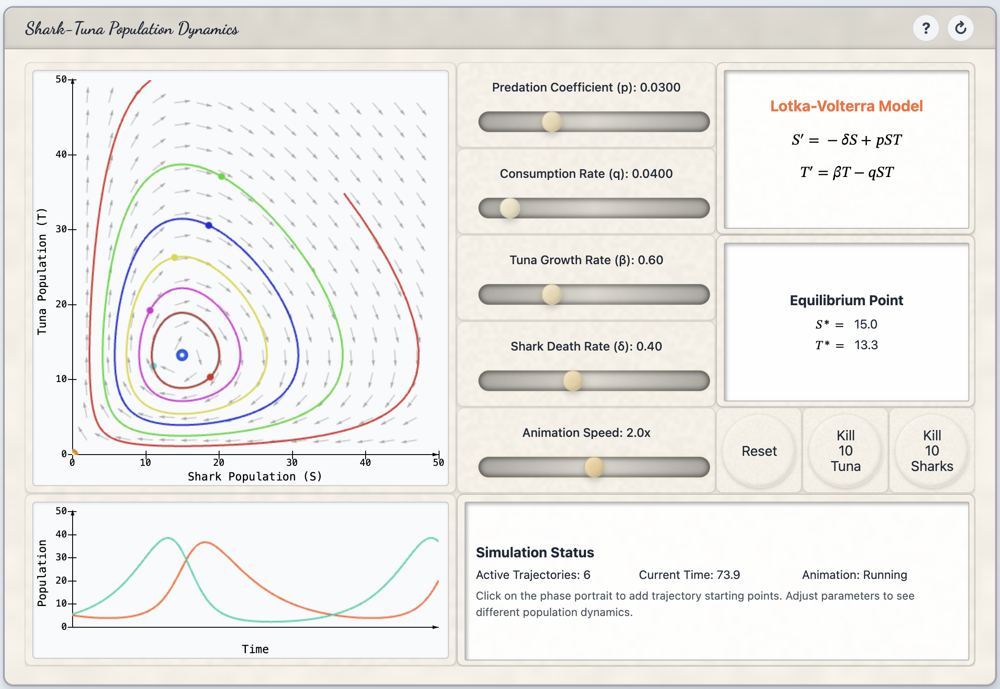

# Modeling Synthesizer

[](https://opensource.org/licenses/MIT)
[](https://martyweissman.github.io/modeling-synthesizer/)

**Interactive simulations for mathematical biology education**

A free, open-source collection of browser-based tools for exploring dynamical systems, differential equations, and mathematical models in the life sciences.

## [Launch the Modeling Synthesizer](https://martyweissman.github.io/modeling-synthesizer/)



## What is this?

The Modeling Synthesizer provides interactive simulations that help students visualize and understand mathematical concepts in biology. Each tool features real-time parameter adjustment, animated visualizations, and immediate feedback.

These tools are designed for undergraduate courses in mathematical biology, dynamical systems, and quantitative life sciences.

## Available Tools

### Ecology & Population Dynamics
- **Shark-Tuna Interactions** - Count predator-prey encounters in a random spatial layout
- **Shark-Tuna Trajectories** - Phase space visualization of Lotka-Volterra predator-prey dynamics
- **Holling-Tanner Predator-Prey Model** - Predator-prey dynamics with a Type II functional response
- **Logistic Growth Explorer** - Carrying capacity and S-curve population dynamics, with data fitting
- **Self-Interaction Explorer** - Random encounters between organisms, the crowding effect behind logistic growth
- **Generalized Lotka-Volterra Model** - Two-species competition, predation, and mutualism
- **Discrete Logistic Model Explorer** - Period doubling, bifurcations, and chaos
- **Hutchinson Population Growth Simulator** - Time-delayed population dynamics

### Physiology & Pharmacokinetics
- **Insulin-Glucose Regulation** - Homeostasis and feedback control with meal challenges
- **Minimal Insulin-Glucose Simulator** - A first look at the insulin-glucose model
- **Caffeine Metabolism** - Exponential decay with multiple daily doses
- **Gentamicin Dosage Simulator** - Therapeutic ranges and toxicity thresholds
- **Muscle Tremor Simulator** - Delay differential equations in neural control
- **FitzHugh-Nagumo Neuron Model** - Action potential dynamics and excitability
- **Ion Channel Simulator** - Stochastic opening and closing of a single ion channel

### Biochemistry & Biophysics
- **Higgins-Sel'kov Glycolysis Model** - Metabolic oscillations with nullclines and vector fields
- **Brownian Motion Simulator** - Random particle diffusion with the Stokes–Einstein equation
- **Atmospheric Molecule Simulator** - Random thermal motion with gravity, and the resulting density profile
- **Simple Harmonic Oscillator** - Position-momentum phase space and periodic motion

### Randomness & Evolution
- **Rapid Coin Flipper** - Probability, random walks, and statistics
- **Tree Ring Simulator** - Random annual growth and the spread of total growth
- **Growth & Collapse Simulator** - A Markov process that grows step by step or collapses to zero
- **Yule Process Simulator** - Stochastic birth and death of cells
- **Genetic Drift Simulator** - Random allele-frequency changes, fixation, and loss

### Matrix & Markov Models
- **Two Compartment Markov Model** - Stochastic transitions between two compartments
- **Three-Compartment Matrix Model** - Discrete-time dynamics of three compartments via matrix multiplication
- **2D Matrix Visualizer** - A 2×2 matrix as a linear map of the plane, with eigenvectors
- **Leslie Matrix Population Model** - Age-structured population dynamics

### Mathematical Tools
- **Dynamical Systems Calculator** - Custom differential equations with vector fields
- **1D Dynamical System Calculator** - Phase line analysis and stability
- **Linear Regression with Log Scaling** - Data visualization and fitting on linear and log scales

### Study Aides
- **Discrete Modeling Practice** - Randomized practice problems for difference equations
- **Trajectory & Time Series Practice** - Understanding phase portraits vs. time series

## Features

- **Real-time visualization** - See how changing parameters affects system behavior instantly
- **Phase portraits** - Vector fields, nullclines, and trajectory plotting
- **Time series plots** - Watch variables evolve over time
- **No installation required** - Runs entirely in your web browser
- **Not yet mobile-friendly** - Meant for desktops and laptops. May work on tablets. Not recommended for phones and other small screens.
- **Dark mode** - Easy on the eyes for late-night studying
- **Help system** - Built-in documentation for each tool

## For Educators

These tools are free to use in your courses. Each simulation is designed to support specific learning objectives:

- **Visualizing abstract concepts** - Students can see what differential equations "do"
- **Parameter exploration** - Discover how parameters affect stability, oscillations, and equilibria
- **Building intuition** - Develop qualitative understanding before formal analysis
- **Active learning** - Interactive exploration during lectures or labs

Direct links to specific tools can be shared with students:
```
https://martyweissman.github.io/modeling-synthesizer/?tool=insulin-glucose
https://martyweissman.github.io/modeling-synthesizer/?tool=shark-tuna-trajectory
```

## Contributing

Interested in contributing or running the project locally? See [CONTRIBUTING.md](CONTRIBUTING.md) for development setup and guidelines.

## License

Released under the [MIT License](LICENSE). You are free to use, modify, and share it, including in your own courses.

## Author

Created by Martin Weissman for undergraduate mathematical biology education.
